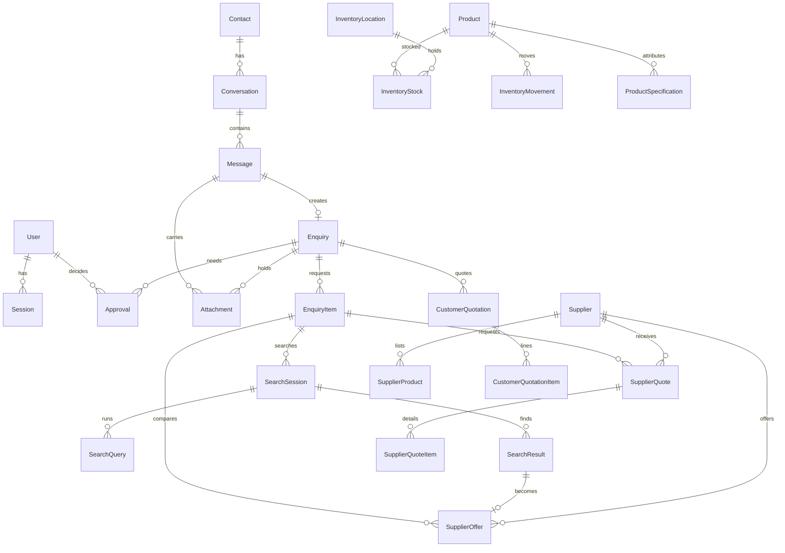

# Database

- ORM: Prisma 6
- Default provider: SQLite (`DATABASE_URL="file:./dev.db"`), migrations in `prisma/migrations`
- PostgreSQL is supported by changing `datasource.db.provider` and `DATABASE_URL`, then creating a fresh migration baseline.

Because SQLite has no native enums or JSON columns, statuses are validated strings (constants live in `src/lib/constants.ts`) and structured payloads are JSON text parsed through typed helpers (`src/lib/json.ts`). This is intentional: the same code runs on PostgreSQL after converting those columns to `jsonb`/enums.

## Entity map



## Key models

### People and access
- **User** — owner or staff, bcrypt password hash, JSON permission list for staff.
- **Session** — hashed bearer token, expiry, IP/user-agent. Sessions are revoked on deactivation.
- **AuditLog** — append-only record (`actorLabel`, action, entity, metadata, time).

### Intake
- **Contact** — a customer/supplier family/personal person, matched by phone or email.
- **ExcludedContact** — normalised phone/email plus category. Checked *before* message storage.
- **Conversation** / **Message** — provider threads; `externalMessageId` is unique (the dedupe guarantee).
  `bodyRetained=false` records that a personal message body was deliberately not kept.
- **Attachment** — content-sniffed MIME, size, SHA-256, storage path, extraction status/note.
  Unique on `(messageId, sha256)` so the same file cannot be processed twice for one message.

### Enquiry
- **Enquiry** — source channel, customer snapshot, raw text, classification + confidence, workflow status
  (`NEW → EXTRACTING → NEEDS_REVIEW/READY → SOURCING → AWAITING_APPROVAL → APPROVED → QUOTED → CLOSED`),
  `extractedJson` (immutable original), `isDemo`.
- **EnquiryItem** — one requested product: raw and corrected attributes, quantity/unit, `missingFields`,
  `clarificationQuestion`, stock split (`quantityFromStock`, `quantityToSource`), `inventoryStatus`,
  `sourcingStatus`, `approvedOfferId`, `extractedJson`, stock-check snapshot.

### Inventory
- **Product** — SKU, category, technical attributes, flexible `specs` JSON, demo flag.
- **ProductSpecification** — key/value extras for categories with unusual attributes.
- **InventoryLocation**, **InventoryStock** (on hand + reserved, unique per product/location, `lastUpdatedAt`),
  **InventoryMovement** (audit of every change, with reason and actor).

### Suppliers and sourcing
- **Supplier** — identity, contacts, categories/brands JSON, status (`ACTIVE/PAUSED/BLOCKED/UNVERIFIED`), notes.
- **SupplierContact**, **SupplierProduct** (recorded catalogue prices with date and source URL).
- **SearchSession** — one discovery run per item: status, per-adapter coverage JSON, summary JSON.
- **SearchQuery** — each phrase per adapter with result count and error.
- **SearchResult** — evidence: URL, supplier, title, snippet, price text, MOQ, availability,
  retrieval timestamp, match status/confidence, evidence JSON. Never overwritten.
- **SupplierOffer** — comparable offer: supplier, product title, match status, price/currency, MOQ,
  shipping/other/taxes, lead time, validity, source type, verification status,
  `landedCostJson` snapshot (cost + eligibility + rank), eligibility reason, demo flag.
  Unique `searchResultId` prevents the same result becoming two offers.
- **SupplierQuote** / **SupplierQuoteItem** — outbound RFQ with secure token, expiry and the supplier's submitted price.
  A submitted quote creates a new `SupplierOffer` with `sourceType=SUPPLIER_QUOTE`.

### Commercial control
- **Approval** — `SOURCING | SUPPLIER_QUOTE_SEND | CUSTOMER_QUOTATION | PRICING_OVERRIDE`,
  target entity, payload snapshot, decision, decider, reason, timestamps. Decisions are single-shot.
- **PricingRule** — scope (`GLOBAL`/`CATEGORY`), type (`PERCENT_MARKUP`/`FIXED_MARKUP`/`MANUAL`), value, priority, active.
- **CustomerQuotation** / **CustomerQuotationItem** — number, version, totals, internal cost, terms, validity,
  approval record, PDF path. Lines keep the supplier offer they came from and the cost price (internal only).
- **Integration** — status, non-secret config, AES-256-GCM encrypted secrets, last check/error.
- **BackgroundJob** — queue (see architecture), unique idempotency key.
- **Notification**, **ExchangeRate** (rate + source + timestamp), **AppSetting**.

## Invariants enforced in code

1. `Message.externalMessageId` unique → a provider retry cannot create a second enquiry.
2. Stock is only consumed by an `EXACT`/`EQUIVALENT` match; available quantity is never negative.
3. An offer is eligible only with a matching specification, sufficient quantity, acceptable MOQ,
   valid quote date and supplier not blocked.
4. Ranking uses only eligible offers with a complete landed cost. Incomplete or ineligible offers stay visible.
5. `Approval.status` can leave `PENDING` once. The decision, decider and reason are persisted.
6. A quotation line records its supplier offer and internal cost; customer documents never include them.
7. A supplier quote response is accepted once and only before expiry.

## Migrations

```bash
npx prisma migrate dev --name describe_change   # development
npx prisma migrate deploy                       # production
npx prisma migrate status                       # verify applied migrations
```

The test suite builds a separate database with `prisma db push --force-reset` (never the development database).

## Indexing notes

- `Message(conversationId, receivedAt)`, `Enquiry(status)`, `EnquiryItem(sourcingStatus)`, `SupplierOffer(enquiryItemId)`,
  `SearchSession(enquiryItemId)`, `BackgroundJob(status, runAfter)`, `AuditLog(entityType, entityId)` support the
  dashboard and worker queries.
- Offer evidence and extraction payloads are text JSON; if you move to PostgreSQL, add GIN indexes as needed.
