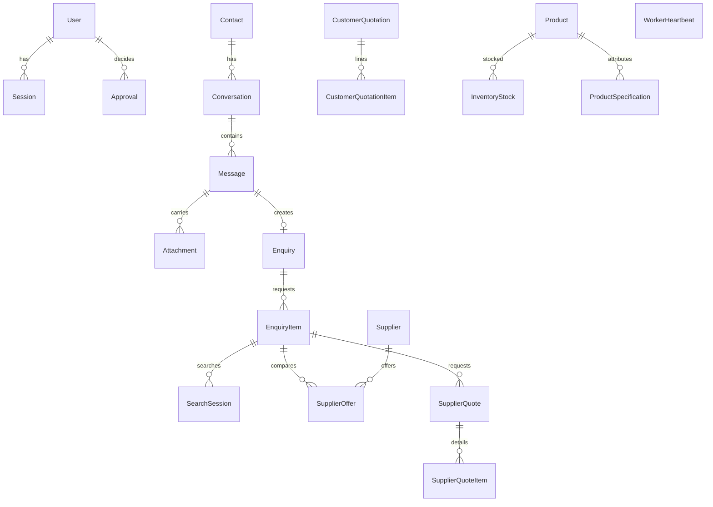

# Database

- ORM: Prisma 6
- Provider: **PostgreSQL 14+** (`prisma/schema.prisma`, `DATABASE_URL="postgresql://…"`)
- Migrations: `prisma/migrations` (forward-only). `prisma/migrations-sqlite-legacy` is old history and is
  **not** used by the active datasource.

Statuses are validated strings (constants in `src/lib/constants.ts`) and structured payloads are JSON text
parsed through typed helpers (`src/lib/json.ts`) or zod schemas. That keeps migrations additive and avoids
enum rewrites when workflow states are added.

## Entity map



## Key models

### People and access
- **User** — owner or staff, bcrypt hash, JSON permission list for staff.
- **Session** — hashed bearer token, expiry (`AUTH_SESSION_DAYS`), IP/user-agent.
- **AuditLog** — append-only record of decisions, sends, edits and demo simulations.

### Intake
- **Contact / ExcludedContact** — identity is canonical E.164/email; exclusions are checked before storage.
- **Conversation / Message** — `externalMessageId` unique (provider retries are idempotent).
  `bodyRetained=false` records a deliberately unretained personal message.
- **Attachment** — content-sniffed MIME, size, SHA-256, private storage key, extraction status.

### Enquiry and specification
- **Enquiry** — channel, customer snapshot, raw text, classification, workflow status, immutable
  `extractedJson`, `isDemo`.
- **EnquiryItem** — corrected attributes, quantity/unit, `missingFields`, clarification question,
  stock split, sourcing state, `approvedOfferId`.
  Fastener lines additionally store a validated `fastenerSpecJson` plus indexed columns
  (`fastenerType`, `diameter`, `threadSeries`, `pitchMm`, `lengthMm`, `propertyClass`, `finish`) and
  provenance (`specSource` = EXTRACTED | MANUAL | SUPPLIER_CONFIRMED, `specConfirmedAt`).
  The JSON shape lives in `src/lib/fasteners/spec.ts` and is versioned.

### Inventory
- **Product** — SKU, category, attributes, flexible `specs`, and `fastenerSpecJson` for fasteners.
- **ProductSpecification**, **InventoryLocation**, **InventoryStock** (on hand + reserved),
  **InventoryMovement** (audit of every change).

### Suppliers and sourcing
- **Supplier**, **SupplierContact**, **SupplierProduct** (recorded catalogue prices).
- **SearchSession / SearchQuery / SearchResult** — one discovery run and its evidence.
- **SupplierOffer** — comparable offer, match status, price/currency, MOQ, freight/other/taxes,
  lead time, validity, source type, verification status, `landedCostJson` snapshot,
  `offeredSpecJson` (validated supplier-stated fastener specification), eligibility reason.
- **SupplierQuote / SupplierQuoteItem** — outbound RFQ with single-use expiring token and response.

### Commercial control
- **Approval** — `SOURCING | SUPPLIER_QUOTE_SEND | CUSTOMER_QUOTATION | PRICING_OVERRIDE`. Decisions are
  single-shot (`updateMany … WHERE status='PENDING'`).
- **PricingRule**, **CustomerQuotation / CustomerQuotationItem** — customer totals, internal cost
  (owner-only), approval and PDF path.
- **BackgroundJob** — durable queue with leases and per-job `maxAttempts`.
- **WorkerHeartbeat** — one row per running worker process; `lastSeenAt` drives liveness. It is never
  inferred from `BackgroundJob.heartbeatAt`, which is cleared when a job completes.
- **Integration**, **Notification**, **ExchangeRate**, **AppSetting**, **NumberSequence**.

## Invariants enforced in code

1. `Message.externalMessageId` unique → a provider retry cannot create a second enquiry.
2. Stock is used only by an `EXACT`/`EQUIVALENT` match; available quantity is never negative.
3. Fastener matching is deterministic: a conflict in type, diameter, thread/pitch, length, material,
   property class, finish or a customer-specified standard is `NO_MATCH`; an unstated required attribute
   is `INSUFFICIENT`. Text similarity never overrides either.
4. Ranking uses only eligible offers with a complete landed cost. Incomplete or ineligible offers remain
   visible with the reason.
5. An `Approval` leaves `PENDING` once.
6. Quotation lines may keep an internal supplier cost; customer records and PDFs never include it.
7. Queue transitions are compare-and-set on `(id, status, lockedBy, unexpired lease)`.

## Migrations

```bash
npx prisma migrate dev --name describe_change   # development
npx prisma migrate deploy                       # demo/staging/production
npx prisma migrate status
```

Migrations are additive. Never run `prisma migrate reset`, `db push --force-reset`, `DROP TABLE` or
`TRUNCATE` against a database containing demo or production data.

The latest migrations are additive: `20261118120000_fastener_specs_and_worker_heartbeat` adds nullable
fastener columns, indexes and the `WorkerHeartbeat` table; `20261118130000_approval_pending_only_unique`
replaces the old `(type, entityId, status)` approval uniqueness with a partial unique index on `PENDING`
rows only, so decided approvals remain as history and re-approval no longer crashes. Existing IDs,
quantities and relationships are preserved.

## Tests

Tests use a dedicated database (`mfbmt_test` by default, `TEST_DATABASE_URL` to override). The global
setup refuses a URL that looks like the development or production database and applies committed
migrations with `prisma migrate deploy`. It never resets the development database.

## Indexing notes

- `Message(conversationId, receivedAt)`, `Enquiry(status)`, `EnquiryItem(sourcingStatus)`,
  `EnquiryItem(fastenerType, diameter)`, `SupplierOffer(enquiryItemId)`, `SearchSession(enquiryItemId)`,
  `BackgroundJob(status, runAfter)`, `BackgroundJob(status, leaseExpiresAt)`,
  `WorkerHeartbeat(lastSeenAt)`, `AuditLog(entityType, entityId)`.
